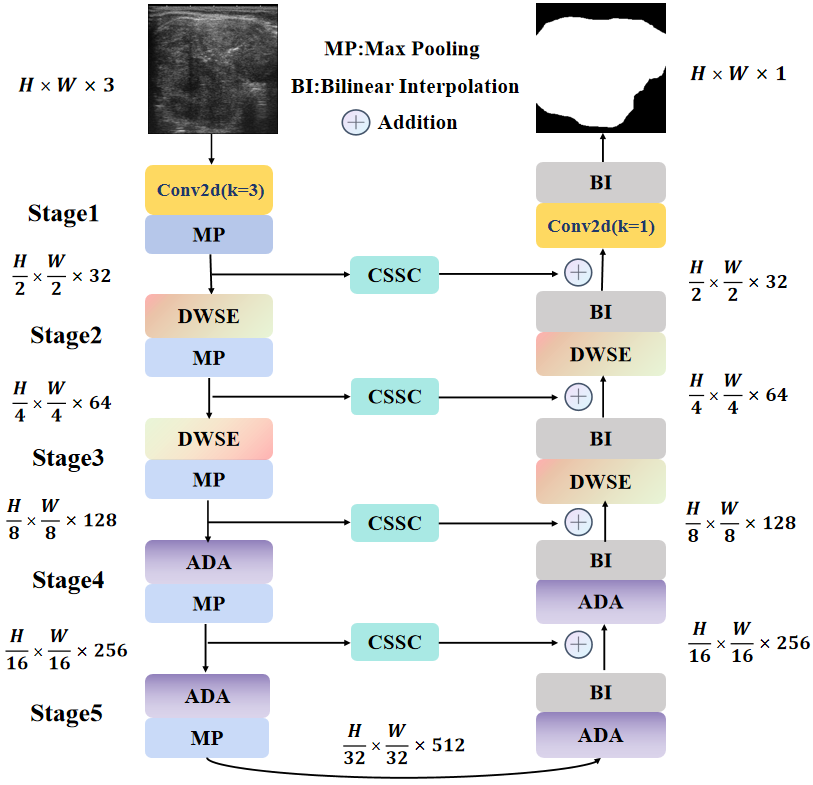

# DAC-Net





## Main Environments

- python 3.9
- pytorch 2.1.0
- torchvision 0.16.0


## Requirements

Install from the `requirements.txt` using:

```
pip install -r requirements.txt
```


## Prepare the dataset.

- The DDTI datasets, can be found here ([link](http://cimalab.intec.co/applications/thyroid/))
- The TN3K datasets, can be found here ([link](https://github.com/haifangong/TRFE-Net-for-thyroid-nodule-segmentation))


## Reference
- [UNet](https://github.com/ZJUGiveLab/UNet-Version)
- [UNet++](https://github.com/ZJUGiveLab/UNet-Version)
- [UNet3+](https://github.com/ZJUGiveLab/UNet-Version)
- [MultiResUNet](https://github.com/makifozkanoglu/MultiResUNet-PyTorch)
- [TransUNet](https://github.com/Beckschen/TransUNet)
- [UCTransNet](https://github.com/McGregorWwww/UCTransNet)
- [ACC_UNet](https://github.com/qubvel/segmentation_models.pytorch)


